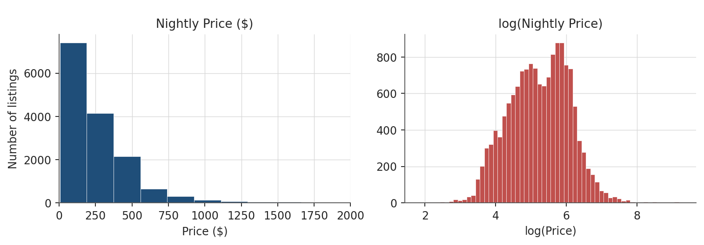
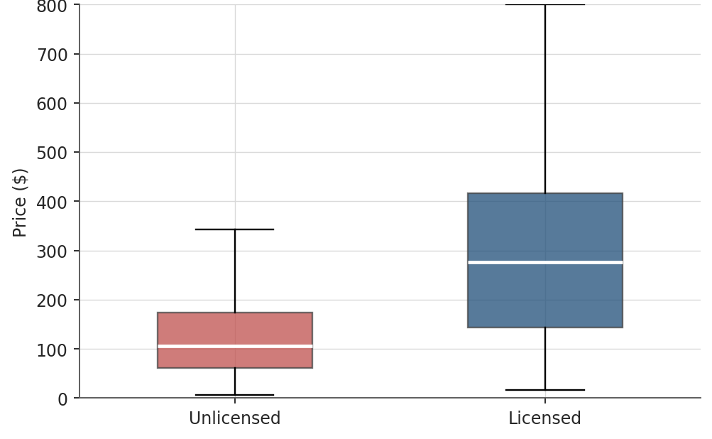
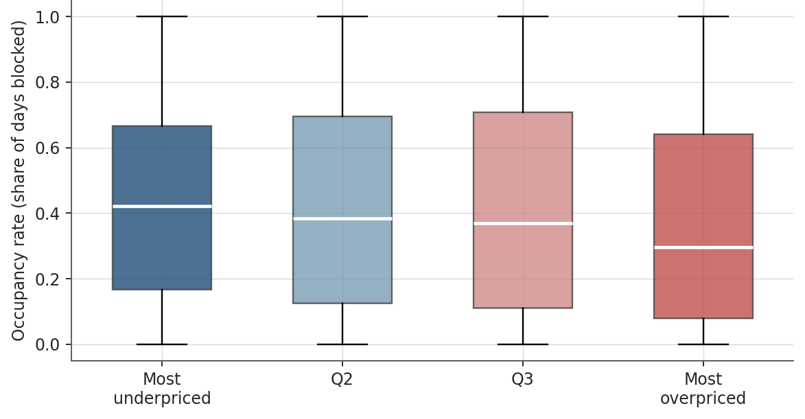

# Toronto Airbnb Pricing: What Drives Nightly Price, and Do Licensed Listings Play by Different Rules?

**Multiple regression · Regression diagnostics · Hypothesis testing (F-test, Chow test) · Python**

Team project for MMA 860 (The Acquisition and Management of Data), Master of Management Analytics, Smith School of Business, Queen's University.

📄 **[Read the full report (PDF)](report/Toronto_Airbnb_Pricing_Report.pdf)** · 💻 **[View the analysis notebook](notebooks/Airbnb_Toronto_Analysis.ipynb)**

---

## Business Problem

Toronto Airbnb hosts set nightly prices with no easy way to benchmark against comparable listings. Price too low and they leave revenue on the table; price too high and they risk empty nights.

On top of that, Toronto's short-term rental bylaw (Municipal Code Chapter 547) requires hosts to register with the City. **35% of listings show no registration number.** We asked:

1. What characteristics actually drive nightly price?
2. Do licensed and unlicensed listings follow the **same** pricing relationship, or are they two different markets?
3. Does overpricing measurably hurt occupancy?

## Data

| Dataset | Source | Size |
|---|---|---|
| Toronto listings (detailed) | [Inside Airbnb](https://insideairbnb.com/get-the-data/) (May–June 2026 snapshot) | 15,869 listings, 90 fields |
| Toronto calendar | Inside Airbnb | 8.11 million date-level rows |
| Licensing rules | City of Toronto, Municipal Code Chapter 547 | Used to define the `licensed` variable |

After cleaning, the modelling dataset has **15,003 listings**, split 80/20 into training (12,003) and a held-out test set (3,000). See [`data/README.md`](data/README.md) for download instructions.

## Approach

1. **Data cleaning**: converted text prices to numbers, parsed bathroom counts from free text, imputed bedrooms and beds by property-type median, and flagged missing review scores
2. **Feature engineering**: one-hot encoded room type and neighbourhood (140 neighbourhoods grouped into the top 14 plus "Other"), and created a binary `licensed` flag
3. **Hedonic pricing model**: OLS regression of price on size, room type, location, host traits and licensing status
4. **Log-price refinement**: re-estimated on log(price) to handle the heavily right-skewed price distribution
5. **Diagnostics**: VIF (collinearity), Breusch-Pagan (heteroskedasticity) with HC1 robust standard errors, and Cook's Distance (influential listings)
6. **Hypothesis tests**: joint F-test on the neighbourhood block, and a Chow test (fully interacted model) for licensed vs. unlicensed listings
7. **Extension**: tested whether trust and professionalization signals explain the licensing premium, and linked price residuals to calendar-based occupancy
8. **Validation**: out-of-sample RMSE and MAE on the held-out test set



## Key Findings

| Result | Finding |
|---|---|
| **Model fit** | The log-price model explains **73%** of price variation (R² 0.73 vs. 0.30 for raw price) |
| **Biggest lever** | Room type: a private room prices **~44% lower** than an entire home |
| **Size** | Each extra bathroom adds **~14%**; bedrooms and guest capacity also add significantly |
| **Surprising result** | More beds *without* more rooms **lowers** price (−5.6%), suggesting a "budget / bunk" signal |
| **Location** | Neighbourhood matters as a block (F = 170.9, p ≈ 0) |
| **Licensing** | Licensed listings average **$331/night vs. $165**; the Chow test (F = 62.07, p ≈ 0) shows a **structurally different pricing relationship**, not just a price gap |
| **Counter-intuitive** | Unlicensed listings belong to hosts with **larger** portfolios (median 3 listings vs. 1), consistent with the bylaw's principal-residence rule |
| **Overpricing** | Median occupancy falls from **42%** for the most underpriced quartile to **30%** for the most overpriced |
| **Prediction** | Log model has lower typical error on unseen listings (MAE **$98.84** vs. $115.64) |





## Recommendations

**For hosts**
- Price mainly off size, room type and location, and use the log-price model as a benchmark
- Add a bedroom or bathroom to raise capacity; adding only beds signals a budget listing
- Treat a large positive pricing residual as an early warning of overpricing

**For the City of Toronto**
- Licensed and unlicensed listings behave like two separate markets
- Unlicensed activity leans toward larger multi-listing operators, a useful signal for prioritizing Chapter 547 enforcement

## Limitations

Single snapshot (no seasonality), availability used as a proxy for bookings, some size variables imputed, and all results are correlational rather than causal. Full list in the report.

## Repository Structure

```
toronto-airbnb-pricing/
├── README.md
├── report/
│   └── Toronto_Airbnb_Pricing_Report.pdf
├── figures/          # charts used in the report
├── notebooks/
│   └── Airbnb_Toronto_Analysis.ipynb   # full analysis, cleaning to validation
├── data/
│   └── README.md     # how to download the Inside Airbnb data
└── requirements.txt
```

## How to Run

```bash
pip install -r requirements.txt
# download the data into data/ (see data/README.md)
cd notebooks
jupyter notebook Airbnb_Toronto_Analysis.ipynb
```

The train/test split uses a fixed random seed (42), so every number in the report is reproducible.

## Tools

Python (pandas, NumPy, statsmodels, SciPy, Plotly) · OLS regression · Wald / F-tests · Chow test · Breusch-Pagan · VIF · Cook's Distance

## Team

Team Isabel, MMA 860, Smith School of Business, Queen's University:
ChunHao (Hansel) Tung · Daniella Zuluaga · Egheomwanre Edosa · Mianhe Zhang · Weizhou Yang · Zubaeerul Islam

---

*Data is publicly available from Inside Airbnb under its terms of use. This project is for academic purposes.*
